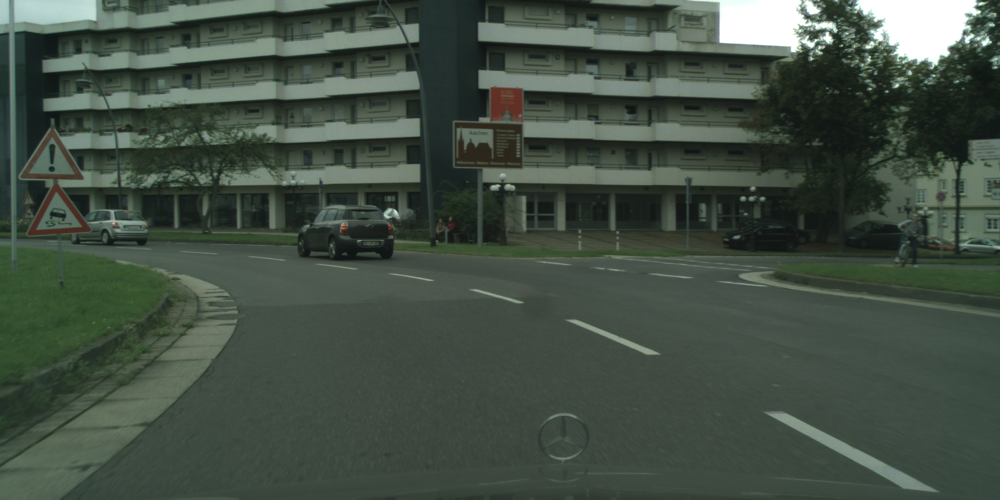
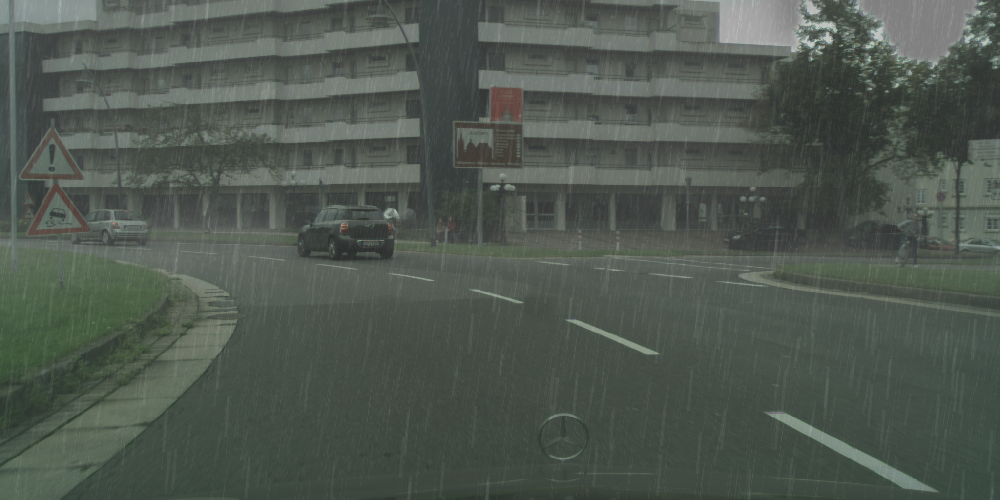
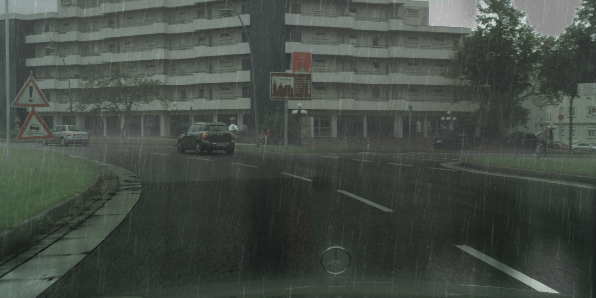

# 🌧️ CascadeRS: Realistic Rain and Wet Surface Synthesis

Official implementation of **CascadeRS**, presented in:

**Rain Beyond Streaks: Cascaded Realistic Rain and Wet Surface Synthesis via Scene Priors**

*WACV 2027*

📄 **Paper:** https://arxiv.org/abs/2611.07793

💻 **Code:** https://github.com/nis-research/CascadeRainSynthesis

CascadeRS is a training-free Python framework for generating realistic synthetic rain and wet-weather effects on outdoor images. It combines pretrained scene priors with procedural rendering to simulate rain streaks, atmospheric fog, wet surfaces, and puddles.

The framework supports different rain intensity levels and can be used to generate synthetic adverse-weather datasets for training and evaluating computer vision models.

---

## Features

- 🌧️ **Depth-aware rain streaks:** Generate rain streaks with varying lengths, densities, and transparency based on scene depth.
- 🌫️ **Atmospheric and ground fog:** Simulate haze using estimated depth information.
- 💦 **Wet surfaces:** Render wet ground appearances and reflections.
- 💧 **Puddles:** Generate puddles using semantic segmentation, perspective transformations, and reflection effects.
- 🎛️ **Controllable intensity:** Adjust rain intensity from 0 to 100.
- 🔧 **Training-free:** No additional training is required to generate rainy images.

The default implementation uses:
- [MiDaS Small](https://github.com/isl-org/MiDaS) for monocular depth estimation.
- [SegFormer-B2](https://huggingface.co/nvidia/segformer-b2-finetuned-ade-512-512) trained on ADE20K for semantic segmentation.

---

## Qualitative Examples

The following example illustrates the different stages of CascadeRS on an image from the [Cityscapes dataset](https://www.cityscapes-dataset.com/).

| Original | Rain + Fog |
|:--------:|:----------:|
|  |  |
| **Wet Surfaces** | **Puddles** |
|  |  |

The **Base** output includes rain streaks and fog, **Wet** additionally includes wet surface reflections, and **Puddles** adds puddle formation and reflections.

---

## Project Structure

The pipeline uses the following directories:

| Folder | Description |
|--------|-------------|
| `Input/` | Input images (JPEG or PNG). |
| `Output/` | Generated images with different weather effects. |
| `Output/Base/` | Rain streaks and fog. |
| `Output/Wet/` | Rain streaks, fog, and wet surfaces. |
| `Output/Puddles/` | Rain streaks, fog, wet surfaces, and puddles. |
| `DepthMaps/` | Estimated or user-provided depth maps. |
| `GroundMasks/` | Estimated or user-provided semantic ground masks. |
| `SS_GT/` | Optional Cityscapes ground-truth semantic segmentation masks. |
| `RainMasks/` | Intermediate rain-streak masks generated during rendering. |

### Depth Maps

If a depth map is not available, the pipeline automatically generates one using MiDaS Small.

To provide an existing depth map, place it in `DepthMaps/` using the naming convention:

`image_name_depth.png`

Depth maps should be grayscale PNG images.

### Ground Masks

If a semantic ground mask is not available, the pipeline generates one using SegFormer-B2.

To provide an existing ground mask, place it in `GroundMasks/` using the naming convention:

`image_name_ground.png`

The masks identify ground surfaces such as roads, sidewalks, and other relevant surface categories.

For Cityscapes images, ground-truth semantic segmentation masks can optionally be provided in `SS_GT/`. When available, these are used for puddle generation instead of the predicted segmentation masks.

---

## Setup Instructions

### 1. Clone the Repository

```bash
git clone https://github.com/nis-research/CascadeRainSynthesis.git
cd CascadeRainSynthesis
```

### 2. Create Conda Environment

Create the environment using the provided `environment.yml`:

```bash
conda env create -f environment.yml
conda activate rain-synthesis
```

The pretrained MiDaS and SegFormer models are downloaded automatically when first used, unless they are already cached.

---

## Running the Code

Run the complete pipeline with:

```bash
python main.py
```

By default, the pipeline:

1. Reads images from `Input/`.
2. Generates missing depth maps using MiDaS.
3. Generates missing ground masks using SegFormer.
4. Synthesizes weather effects.
5. Saves all three output variants in `Output/`.

When no intensity is specified, a random rain intensity between 10 and 75 is selected for each image.

### Optional Command-Line Arguments

| Argument | Description |
|----------|-------------|
| `--input_dir` | Input image directory (default: `Input`). |
| `--output_dir` | Output directory (default: `Output`). |
| `--depth_dir` | Depth map directory (default: `DepthMaps`). |
| `--ground_dir` | Ground mask directory (default: `GroundMasks`). |
| `--intensity` | Rain intensity between 0 and 100. Random if omitted. |
| `--save_base` | Save rain and fog images. |
| `--save_wet` | Save rain, fog, and wet surface images. |
| `--save_puddles` | Save rain, fog, wet surface, and puddle images. |

If no save flags are specified, **all three output variants** are generated.

### Examples

Generate rain with intensity 50 and save all output variants:

```bash
python main.py --intensity 50
```

Generate only the wet and puddle variants:

```bash
python main.py --intensity 50 --save_wet --save_puddles
```

Use custom input and output directories:

```bash
python main.py --input_dir MyImages --output_dir Results --intensity 70
```

### Additional Parameters for Sensitivity Experiments

The following optional arguments allow individual rendering parameters to be controlled:

| Argument | Description | Default behavior |
|----------|-------------|------------------|
| `--resolution` | Perlin noise resolution. | Randomly selects 4 or 8. |
| `--persistence` | Fractal noise persistence. | Random between 0.4 and 0.45. |
| `--reflection` | Base puddle reflection coefficient. | Fixed at 0.75. |
| `--beta` | Atmospheric haze coefficient. | Random between 4.7 and 6.7. |

For example:

```bash
python main.py --intensity 70 --resolution 8 --persistence 0.42 --reflection 0.75 --beta 5.7
```

When these arguments are omitted, the original CascadeRS parameter settings are used.

---


## Generated Datasets

We use the [Cityscapes dataset](https://www.cityscapes-dataset.com/) as the primary source of images for synthetic rain generation. Cityscapes provides urban driving scenes and corresponding semantic segmentation annotations, which can be used as scene priors for the rendering process.

We generated the following synthetic datasets using CascadeRS.

### 1. Cityscapes with Controlled Rain Intensity

We generated rainy versions of Cityscapes at **10 different intensity levels**:

`10, 20, 30, 40, 50, 60, 70, 80, 90, 100`

Each intensity level represents a different degree of synthetic rain and wet-weather effects, enabling evaluation of computer vision models under progressively more severe weather conditions.

### 2. Cityscapes with Mixed Rain Intensity

We additionally generated a mixed dataset containing:

- **70% original Cityscapes images**
- **30% CascadeRS-generated rainy images**

The rainy images contain different, randomly mixed intensity levels.

This dataset can be used for training computer vision models with synthetic adverse-weather augmentation.

## Citation

If you use CascadeRS or the generated datasets in your research, please cite:

**Melissa Tijink et al.**  
*Rain Beyond Streaks: Cascaded Realistic Rain and Wet Surface Synthesis via Scene Priors.*  
WACV 2027.

**Paper:** https://arxiv.org/abs/2611.07793

```bibtex
@misc{tijink2026rainstreakscascadedrealistic,
    title={Rain Beyond Streaks: Cascaded Realistic Rain and Wet Surface Synthesis via Scene Priors},
    author={Melissa Tijink and Kirill Tolstobrov and Shunxin Wang and Estefania Talavera and Duc V. Le and Luuk Spreeuwers and Shaodi You and Nicola Strisciuglio},
    year={2026},
    eprint={2611.07793},
    archivePrefix={arXiv},
    primaryClass={cs.CV},
    url={https://arxiv.org/abs/2611.07793}
}
```
